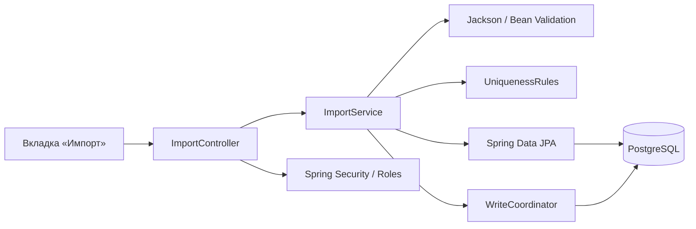
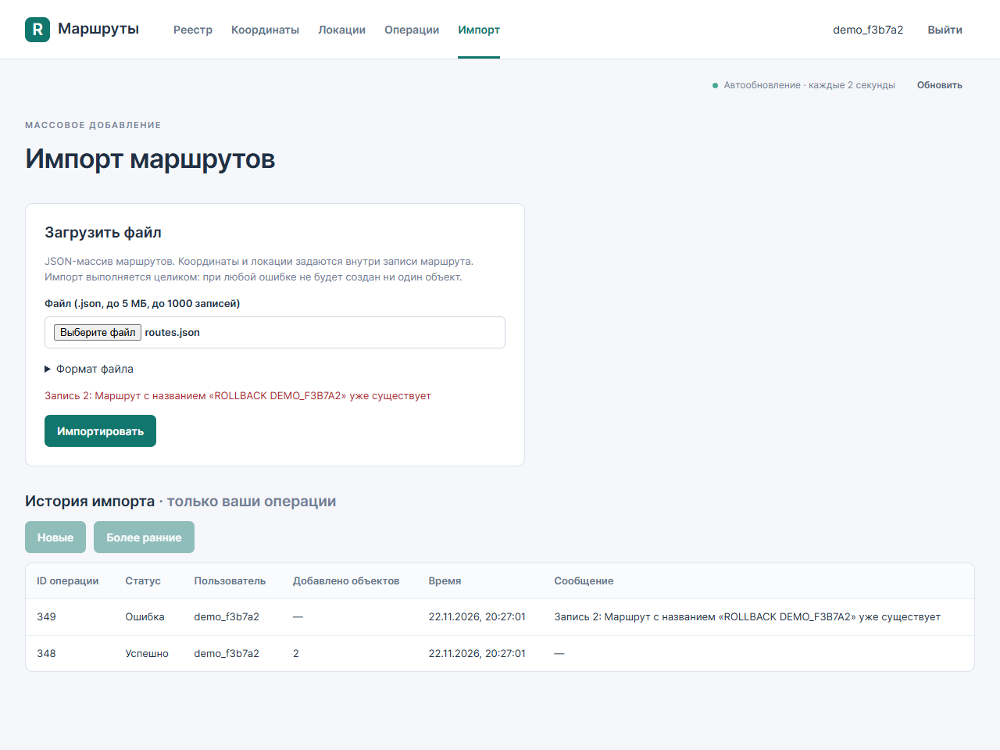
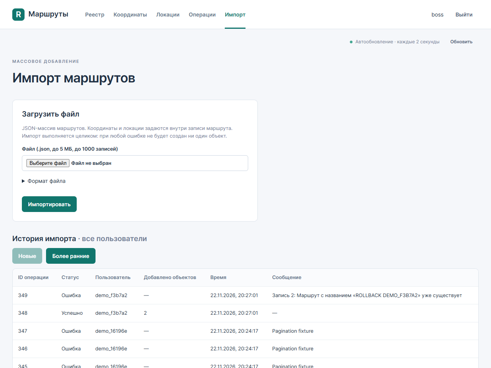

# ИС «Маршруты» · Лабораторная работа № 2

**ИТМО · Информационные системы · Вариант 12028**

Целиков Даниил, Тарасов Владислав · P3319

22 ноября 2026 г.

## 1. Задание и результат

Доработать ИС из ЛР1 для массовой загрузки, валидации и атомарного сохранения маршрутов. Добавить историю с учётом роли, обеспечить программную уникальность и исследовать конкурентные операции в Apache JMeter.

| Требование | Как выполнено и проверено |
|---|---|
| Массовая загрузка | Вкладка «Импорт» отправляет JSON-файл через `multipart/form-data`. JMeter и браузер загрузили файлы через рабочий HTTP API. |
| Валидация ЛР1 и вложенные объекты | `coordinates`, `from` и `to` задаются внутри записи маршрута. Bean Validation проверяет обязательные поля, непустые имена, конечные числа, `distance > 1` и `rating > 0`. |
| Атомарность | Дубликат во второй записи даёт `409`. Повторные запросы проверяют отсутствие маршрута, координат и локации первой записи. |
| История и роли | ID, статус, логин и число маршрутов при успехе. Обычный пользователь видит свои записи, администратор видит записи всех пользователей. История доступна по страницам. |
| Уникальность | Названия маршрутов и локаций сравниваются без учёта регистра и крайних пробельных символов Java. Для координат сравнивается пара `(x, y)`. Ограничения проверяет сервис. |
| Конкурентный доступ | План покрывает параллельный CRUD, импорт, гонки уникальности, PUT/PUT, DELETE/DELETE и PUT/DELETE одного маршрута. |
| Согласование с преподавателем | Формат JSON и три предложенных ограничения реализованы. Подтверждение согласования в материалах проекта отсутствует. |

## 2. Архитектура

Веб-интерфейс использует сессионную авторизацию Spring Security. `ImportController` принимает multipart-запрос и определяет область видимости истории. `ImportService` разбирает, проверяет и сохраняет данные. Репозитории Spring Data JPA обращаются к PostgreSQL, миграции Flyway создают схему и таблицу истории `rl_import`.



Модель ЛР1 сохранена: маршрут связан с обязательными координатами и локацией назначения, а также с необязательной локацией отправления. История хранит отдельные операции импорта. Из трёх новых правил уникальности ни одно не добавлено в схему БД в форме `UNIQUE` или уникального индекса. В каталоге PostgreSQL проверено, что у этих трёх таблиц есть только уникальные индексы первичных ключей.

## 3. Формат файла и история

Файл содержит от 1 до 1000 записей, максимальный размер — 5 МБ. `from` можно опустить или указать как `null`. Локация и координаты с совпадающими данными могут использоваться несколькими маршрутами. Локация с тем же названием и другими координатами даёт конфликт.

```json
[
  {
    "name": "Университет — набережная",
    "coordinates": { "x": 1.5, "y": 2.5 },
    "from": { "name": "Университет", "x": 0, "y": 0, "z": 0 },
    "to": { "name": "Набережная", "x": 5, "y": 4, "z": 0 },
    "distance": 8.5,
    "rating": 4
  }
]
```

Разбор отклоняет неизвестные и повторяющиеся JSON-поля, лишние данные после массива, неверные типы и дробный `z`. Ошибки полей содержат номер записи и путь к полю. Отдельно проверены пустой файл и корневой JSON `null`: обе попытки получают `400` и сохраняются как `FAILED`.

| API под `/routes/api` | Результат |
|---|---|
| `POST /imports` | Multipart-поле `file`. Успех возвращает `201` и строку истории. Неверный ввод даёт `400`, конфликт уникальности — `409`. |
| `GET /imports` | До 200 записей в порядке убывания ID. Для ранних операций используется `?before=<ID>`. Фильтрация по пользователю выполняется на сервере. |

Список администраторов задаёт оператор через `APP_ADMINS`. Сначала создаются учётные записи, затем их логины добавляются в настройку и приложение перезапускается. Публичная регистрация с уже зарезервированным логином отклоняется.



## 4. Транзакции и изоляция

Разбор и валидация всего файла выполняются до транзакции. При сохранении `WriteCoordinator` первой операцией берёт блокировку `PESSIMISTIC_WRITE` на единственной строке `rl_state`. После блокировки приложение проверяет уникальность, сохраняет вложенные объекты и маршруты, затем записывает `SUCCESS` с числом маршрутов. Если любая запись даёт ошибку, изменения и новая ревизия откатываются вместе. После отката `FAILED` сохраняется в отдельной транзакции без счётчика добавленных объектов.

| Операции | Изоляция и причина |
|---|---|
| CRUD, импорт, специальное создание через SQL-функцию, регистрация | `READ COMMITTED` задан явно. Сразу после ожидания блокировки следующая команда видит данные, зафиксированные предыдущим писателем. Блокировка удерживается до завершения транзакции. |
| Список маршрутов и выборка между локациями | Существующий `REPEATABLE READ` даёт один снимок для связанных запросов: подсчёт и страница, проверка локаций и выборка. |
| Карточка маршрута, поиск по части названия и подсчёт использования справочников | Добавлен `REPEATABLE READ` для запросов, которые читают сам объект и связанные данные в несколько обращений к БД. |
| Конкурентные PUT и DELETE | Версия, присланная клиентом, сверяется после блокировки. Первая запись увеличивает версию или удаляет объект. Следующая получает `409` за устаревшую версию или `404` после удаления. |

Контролируемый опыт в PostgreSQL 17.4 использовал два соединения. Первое выполнило `COUNT(*)`, второе вставило и зафиксировало строку, первое запросило список. При `READ COMMITTED` получились `total=1` и строки `1,2`. При `REPEATABLE READ` получились `total=1` и строка `1`. В HTTP-сценарии аналогичный инвариант проверялся на последней странице реестра, пока другие потоки писали данные.

## 5. Исправления по итогам проверки

- Исходный JMX на стенде прошёл 156 сэмплов, но не проверял откат в каждой группе CRUD, содержимое истории, сохранённую уникальность и смешанную гонку. Подпись «admins» относилась к обычным зарегистрированным пользователям. В обновлённом плане заявлены фактические роли. Два администратора дополнительно проверены отдельным скриптом.
- Вспомогательный Python-сценарий отправлял оба запроса PUT и DELETE из каждого потока. Теперь два клиента отправляют по одному запросу с общей исходной версией. Допустимые пары и конечное состояние проверяются явно.
- XML-файл JMeter сам по себе не подтверждает результат. Проверяются ответы, записи в истории и данные после конкурентных операций. Для автоматического запуска добавлена проверка JTL, включая наличие заключительного сэмпла.
- Исправлены ответ `500` на `null`, преобразование дробного `z` к целому и обрезание истории на 200 записях. Уникальность имён теперь проверяется без зависимости от локали PostgreSQL, включая кириллицу.

## 6. Результаты эксперимента

Стенд: JDK 21.0.10, Spring Boot 3.5.0, PostgreSQL 17.4, Apache JMeter 5.6.3. Использовалась отдельная локальная база.

| Проверка | Результат |
|---|---|
| Maven `verify` | 48 тестов, 0 ошибок. |
| JMeter, 10 пользователей CRUD | 206 сэмплов, 0 ошибок. |
| JMeter, 20 пользователей CRUD | 336 сэмплов, 0 ошибок. |
| JTL с намеренно помеченной ошибкой | Скрипт проверки вернул код 1. |
| Отдельная API-проверка | Атомарность, история, кириллические имена, конкурентная запись и чтение, операции двух администраторов прошли. |
| Chromium | Проверены multipart-загрузка, результат отказа, история обеих ролей и переход между страницами при 203 записях. |

В JMeter один из восьми запросов в каждой гонке уникальности получил `201`, остальные получили `409`. PUT/PUT дал один `200` и семь `409`. DELETE/DELETE дал один `204`, последующий GET вернул `404`. В смешанной гонке JMeter первым сработал DELETE, и PUT получил `404`. Дополнительная проверка API зафиксировала обратный порядок: PUT завершился с `200`, DELETE получил `409`.



## 7. Воспроизведение и ограничения

```powershell
mvn verify
java -jar target/routes.jar
```

В другом терминале из корня проекта:

```powershell
jmeter -n -t jmeter/routes-concurrency.jmx -l target/lab2.jtl -j target/lab2-jmeter.log -e -o target/jmeter-report
python jmeter/check_results.py target/lab2.jtl
```

Настройка подключения к БД описана в [README проекта](../README.md). Параметры, порядок подготовки двух администраторов и дополнительный Python-сценарий приведены в [инструкции JMeter](../jmeter/README.md).

Общая блокировка сериализует записи и ограничивает пропускную способность. Инварианты уникальности защищены для операций через приложение. Если контейнер отклоняет запрос до вызова сервиса, например из-за лимита multipart, строка истории не создаётся.

Документация эксперимента: [Apache JMeter — Component Reference](https://jmeter.apache.org/usermanual/component_reference.html), [PostgreSQL — Transaction Isolation](https://www.postgresql.org/docs/17/transaction-iso.html).
