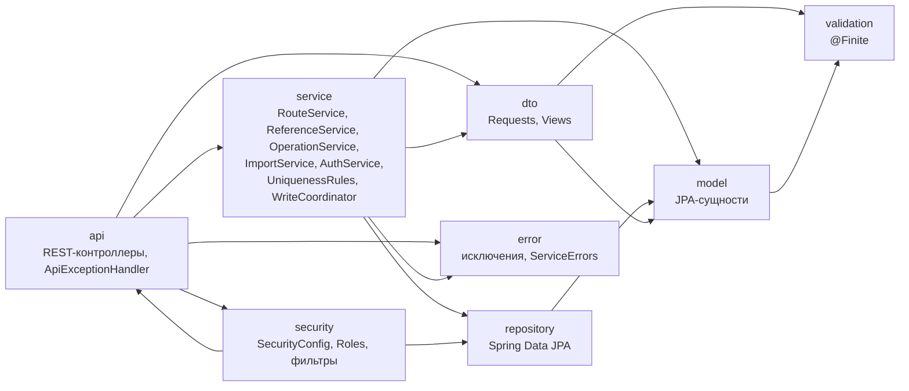
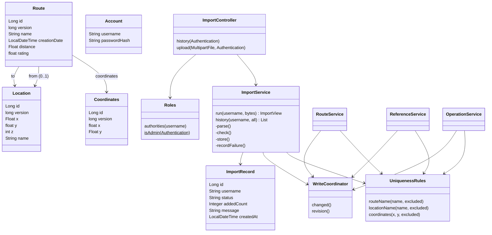

# Лабораторная работа № 2 (доработка ИС из ЛР1)

Вариант 12028 · P3319 · Целиков Даниил, Тарасов Владислав

## 1. Текст задания

Доработать ИС из ЛР1 следующим образом:

1. Добавить в систему возможность массового добавления объектов при помощи импорта файла. Формат для импорта необходимо согласовать с преподавателем. Импортируемый файл должен загружаться на сервер через интерфейс разработанного веб-приложения.
2. При реализации логики импорта объектов необходимо реализовать транзакцию таким образом, чтобы в случае возникновения ошибок при импорте не был создан ни один объект.
3. При импорте должна быть реализована проверка пользовательского ввода в соответствии с ограничениями предметной области из ЛР1.
4. При наличии вложенных объектов в основной объект из ЛР1 необходимо задавать значения полей вложенных объектов в той же записи, что и основной объект.
5. Добавить в систему интерфейс для отображения истории импорта (обычный пользователь видит только операции импорта, запущенные им, администратор — все). В истории должны отображаться id операции, статус её завершения, пользователь, который её запустил, число добавленных объектов в операции (только для успешно завершённых).
6. Согласовать с преподавателем и добавить в модель из первой лабораторной новые ограничения уникальности, проверяемые на программном уровне (эти новые ограничения должны быть реализованы в рамках бизнес-логики приложения и не должны быть отображены/реализованы в БД).
7. Реализовать сценарий с использованием Apache JMeter, имитирующий одновременную работу нескольких пользователей с ИС, и проверить корректность изоляции транзакций, используемых в ЛР. По итогам исследования поведения системы при её одновременном использовании несколькими пользователями изменить уровень изоляции транзакций там, где это требуется. Обосновать изменения.
8. Сценарий должен покрывать создание, редактирование, удаление и импорт объектов.
9. Сценарий должен проверять корректность поведения системы при попытке нескольких пользователей обновить и/или удалить один и тот же объект (например, двух администраторов).
10. Сценарий должен проверять соблюдение ограничений уникальности предметной области при одновременной попытке нескольких пользователей создать объект с одним и тем же уникальным значением.

## 2. Принятые решения (требуют согласования с преподавателем)

| Вопрос | Решение в работе |
|---|---|
| Формат файла импорта | JSON-массив маршрутов; вложенные `coordinates`, `from`, `to` задаются внутри записи маршрута. Лимиты: 5 МБ, 1000 записей. Неизвестные поля запрещены. |
| Уникальность маршрута | Название маршрута, без учёта регистра и крайних пробелов. |
| Уникальность локации | Название локации по тому же правилу. |
| Уникальность координат | Пара (x, y). |
| Вложенные объекты при импорте | Совпавшие по ключу уникальности координаты и локации переиспользуются; локация с тем же названием, но другими x, y, z — ошибка. |
| Администратор | Логины из настройки `app.admins` (переменная `APP_ADMINS`, по умолчанию `admin`). |

Все три ограничения уникальности реализованы только в `UniquenessRules` (бизнес-логика); в миграциях БД уникальных индексов для них нет.

## 3. UML

### 3.1. Диаграмма пакетов

### 3.2. Диаграмма классов (модель и импорт)

## 4. Импорт и транзакции

`ImportService.run` работает в три шага:

1. **Разбор и проверка вне транзакции.** Файл читается строгим Jackson-парсером, затем каждая запись проверяется Bean Validation с теми же ограничениями, что и в ЛР1 (`@NotBlank`, `distance > 1`, `rating > 0`, конечные `float`, вложенные объекты через `@Valid`). Ошибки возвращаются списком вида `запись 2: coordinates.y` → сообщение (до 20 штук). БД на этом шаге не затрагивается.
2. **Одна транзакция на весь файл** (`TransactionTemplate`, READ COMMITTED). Первой командой берётся глобальная блокировка записи (`WriteCoordinator.changed()`), затем для каждой записи проверяется уникальность, создаются или переиспользуются вложенные объекты и сохраняется маршрут. Любое исключение откатывает всю транзакцию: не создаётся ни один объект (включая координаты и локации). Запись об успешном импорте добавляется в той же транзакции.
3. **История неуспешной попытки.** После отката статус `FAILED` и текст ошибки записываются отдельной транзакцией (`REQUIRES_NEW`), поэтому откат импорта их не стирает.

История хранится в таблице `rl_import` (миграция `V3__create_import_history.sql`). `GET /api/imports` возвращает пользователю только его операции, администратору — все. Число добавленных объектов заполняется только для `SUCCESS` (ограничением `CHECK` в БД и в интерфейсе).

## 5. Изоляция транзакций

### 5.1. Что было и что стало

| Операция | Уровень | Обоснование |
|---|---|---|
| Создание, изменение, удаление, импорт, операции записи | READ COMMITTED (без изменений) | Первая команда транзакции — `SELECT … FOR UPDATE` строки `rl_state`: записи выстраиваются в очередь. Все последующие чтения видят данные, зафиксированные предыдущей записью. Поэтому проверка версии (`@Version`) и проверка уникальности корректны. |
| `RouteService.list`, `OperationService.between` | **REPEATABLE READ, read-only** (изменено) | Метод выполняет несколько запросов (`count` и выборка страницы; проверка локаций и выборка). При READ COMMITTED между ними может зафиксироваться чужая запись, и `total` не совпадёт со страницей. REPEATABLE READ даёт всем запросам метода один снимок. Читателям это ничего не стоит: они не блокируют писателей. |
| Остальные чтения | READ COMMITTED | Один запрос, одного снимка достаточно. |

### 5.2. Почему не REPEATABLE READ или SERIALIZABLE для записи

В PostgreSQL снимок REPEATABLE READ фиксируется на первом запросе транзакции, то есть **до** ожидания блокировки. После получения блокировки транзакция продолжила бы читать устаревший снимок и не увидела бы данные только что завершившейся записи; проверка уникальности пропустила бы дубликат, а само обновление строки `rl_state` завершилось бы ошибкой сериализации. SERIALIZABLE дал бы корректность, но ценой повторов транзакций и ошибок клиенту без выигрыша: параллелизм записи всё равно ограничен глобальной блокировкой. READ COMMITTED плюс блокировка первой командой даёт то же самое проще.

### 5.3. Ограничение

Глобальная блокировка записи сериализует все изменения, в том числе длинный импорт (до 1000 записей): другие писатели ждут его завершения. Для лабораторной нагрузки это приемлемо; при росте нагрузки блокировку заменили бы на блокировку по ключам уникальности (advisory-lock на хеш названия).

## 6. Сценарий нагрузки и результаты

План `jmeter/routes-concurrency.jmx` (запуск описан в `jmeter/README.md`) содержит четыре группы потоков, выполняемые последовательно:

1. **CRUD + импорт**, `USERS` параллельных пользователей (по умолчанию 10): регистрация, создание координат, локации и маршрута, изменение маршрута с версией, список, импорт файла (файл генерируется на лету, имена уникальны), история импорта, удаление маршрута.
2. **Подготовка**: общие координаты, локация, маршруты U (для гонки изменения) и D (для гонки удаления); идентификаторы публикуются в свойствах JMeter.
3. **Гонки** (8 потоков, перед каждым запросом Synchronizing Timer): одновременное создание координат с одной парой (x, y), локации с одним названием, маршрута с одним названием, импорт одного и того же файла; одновременное изменение маршрута U и одновременное удаление маршрута D всеми потоками.
4. **Проверка**: ровно один победитель в каждой гонке (счётчики в JSR223), маршрут U изменён ровно один раз (версия выросла на 1), маршрут D удалён (404).

Ожидаемые коды в гонках — только `201/409`, `200/409`, `204/404/409`; любой другой код, в том числе `500`, считается ошибкой.

**Что выполнено в этой работе.** Apache JMeter на машине разработки не установлен, поэтому сам `.jmx` проверен только на корректность XML. Идентичный сценарий выполнен скриптом на Python с 6–8 параллельными потоками против запущенного приложения и PostgreSQL 17; он же проверял откат импорта и видимость истории. Результат: все 21 проверка пройдена.

| Проверка | Результат |
|---|---|
| Импорт двух записей с вложенными объектами | `201`, добавлено 2, общие координаты не дублируются |
| Ошибка валидации во второй записи | `400`, ошибки по полям, ни одного объекта |
| Дубликат названия внутри файла | `409`, откат всего файла |
| Битый JSON | `400`, ничего не создано |
| История | пользователь видит только свои операции, администратор — все; у `FAILED` нет числа добавленных |
| Гонка: одно название маршрута (8 потоков, в том числе с другим регистром и пробелами) | один `201`, семь `409` |
| Гонка: одно название локации (8 потоков) | один `201`, семь `409` |
| Гонка: одна пара координат (8 потоков) | один `201`, семь `409` |
| Гонка: один и тот же файл импорта (6 потоков) | один `201`, пять `409` |
| Изменение одного маршрута двумя администраторами | `200` и `409`, версия выросла ровно на 1 |
| Удаление одного маршрута двумя администраторами | `204` и `404` |
| Изменение и удаление одного маршрута одновременно | один из запросов успешен, второй `409` |
| Чтение страниц во время записи | ни одной несогласованной страницы |

Результаты получены против единственного экземпляра приложения на одной машине; запуск самого `.jmx` в JMeter остаётся за вами (команда в `jmeter/README.md`).

## 7. Выводы

- Импорт реализован как единая транзакция: любая ошибка в любой записи, в том числе нарушение уникальности, откатывает все создаваемые объекты, включая вложенные. История фиксирует и успешные, и неуспешные попытки; неуспешные записываются отдельной транзакцией, иначе откат стёр бы и их.
- Проверка ввода повторяет ограничения предметной области из ЛР1 и выполняется до открытия транзакции, поэтому заведомо некорректный файл не берёт блокировку записи.
- Уникальность на уровне бизнес-логики безопасна только вместе с сериализацией записей. Здесь это глобальная блокировка `rl_state`, взятая первой командой транзакции под READ COMMITTED; без неё проверка «есть ли такое значение» и вставка могли бы чередоваться с чужой записью.
- Оптимистичная блокировка (`version`) защищает от потерянных обновлений при редактировании и удалении одного объекта: проигравший получает `409`, а не затирает чужие изменения.
- Единственное изменение уровня изоляции — REPEATABLE READ (только чтение) для методов с несколькими запросами, чтобы страница и общее число строк брались из одного снимка. Для записи повышать уровень не нужно и вредно (см. п. 5.2). Рассуждения п. 5.2 о поведении REPEATABLE READ и о дубликатах без блокировки получены из устройства PostgreSQL, а не измерены: вариант без блокировки в сценарии не запускался.
- Цена выбранной схемы — сериализация всех записей. Для масштабирования потребовались бы блокировки по ключам уникальности или ограничения уникальности в БД; в этой работе по условию задания их в БД нет.
